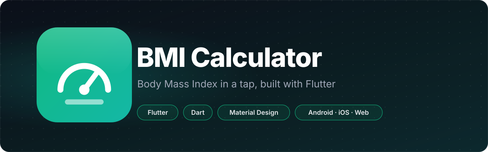
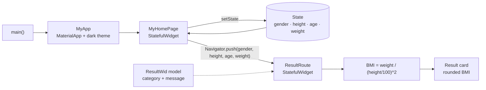

<div align="center">
  
  <p><b>A clean, dark-themed Flutter app that turns height and weight into a Body Mass Index in a single tap.</b></p>
  <p>
    
    
    
    <a href="LICENSE"></a>
    
    
    <a href="https://github.com/ismailbentabett/Bmi-Calculator-App/stargazers"></a>
    
  </p>
  <p><a href="#-quick-start">Quick start</a> · <a href="#-features">Features</a> · <a href="#-architecture">Architecture</a> · <a href="#-contributing">Contributing</a></p>
</div>

## Overview

**BMI Calculator** is a compact Flutter application that collects a user's sex, height, age and weight through touch-friendly cards and computes their Body Mass Index on a dedicated result screen. It is a learning project and reference implementation of core Flutter patterns: stateful widgets, card-based layouts, sliders, stepper buttons and screen-to-screen navigation with constructor arguments.

## ✨ Features

- **Sex selection cards** – tap-to-select *Male* / *Female* cards with a highlighted active state.
- **Height slider** – a Material `Slider` from 0 to 300 cm with 20 discrete steps and a live value label.
- **Age and weight steppers** – circular `+` / `−` buttons that never go below zero.
- **One-tap calculation** – a full-width action pushes a result screen via `Navigator.push`.
- **BMI result screen** – computes `weight / (height / 100)²` and displays the rounded value in a highlighted card.
- **Dark Material theme** – `ThemeData.dark()` with custom card colours for a consistent night-friendly UI.
- **Cross-platform scaffold** – Android, iOS and web runner projects are included.

> [!NOTE]
> The result screen currently shows a fixed "Normal" label alongside the computed number, and sex and age are collected but not yet used in the formula. Category classification is tracked in the [roadmap](#-roadmap).

## 🧱 Tech stack

| Layer        | Technology                                          |
|--------------|-----------------------------------------------------|
| Framework    | Flutter (stable channel, pre-null-safety era)       |
| Language     | Dart, SDK constraint `>=2.1.0 <3.0.0`               |
| UI           | Material widgets, `ThemeData.dark()`                |
| Icons        | Material Icons, `cupertino_icons ^0.1.2`            |
| Navigation   | `Navigator.push` with `MaterialPageRoute`           |
| Math         | `dart:math` (`pow`)                                 |
| Platforms    | Android, iOS, Web                                   |

## 🏗 Architecture



```
lib/
├── main.dart                # App entry, theme and the input screen (MyHomePage)
├── routes/
│   └── result.dart          # ResultRoute: computes and displays the BMI
└── Widgets/
    └── result_class.dart    # ResultWid: category + message model
```

## 🚀 Quick start

### Prerequisites

- [Flutter SDK](https://docs.flutter.dev/get-started/install) **2.x**. The code targets Dart `<3.0.0` without null safety and uses `FlatButton`, so it will not compile on Flutter 3.10+ / Dart 3 without migration.
- An Android emulator, iOS simulator (macOS), or Chrome for the web target.

### Run

```bash
git clone https://github.com/ismailbentabett/Bmi-Calculator-App.git
cd Bmi-Calculator-App
flutter pub get
flutter run            # or: flutter run -d chrome
```

### Build

```bash
flutter build apk      # Android
flutter build web      # Web
```

## ⚙️ Configuration

No configuration is required. The app has no backend, no API keys and no environment variables; all calculation happens on-device.

## 📁 Project structure

```
Bmi-Calculator-App/
├── android/             # Android runner project
├── ios/                 # iOS runner project
├── web/                 # Web runner (index.html, manifest, icons)
├── lib/                 # Application source (see Architecture)
├── test/
│   └── widget_test.dart # Default Flutter widget test scaffold
├── pubspec.yaml         # Package manifest (package name: hello_world)
└── .github/             # Branding assets, issue and PR templates
```

## 🗺 Roadmap

- [x] Input screen with sex, height, age and weight controls
- [x] BMI computation and result screen
- [ ] Classify results into WHO categories (Underweight / Normal / Overweight / Obese) using the existing `ResultWid` model
- [ ] Display one decimal place and colour-code the result by category
- [ ] Migrate to sound null safety and Flutter 3 (replace `FlatButton` with `TextButton`)
- [ ] Replace the default counter test with widget tests for the calculator flow
- [ ] Metric / imperial unit toggle
- [ ] Rename the package from `hello_world` to a project-specific name

## 🤝 Contributing

Contributions are welcome. Please read [CONTRIBUTING.md](CONTRIBUTING.md) for the workflow, branch naming and commit conventions, and follow the [Code of Conduct](CODE_OF_CONDUCT.md).

## 🔒 Security

Please report vulnerabilities privately as described in [SECURITY.md](SECURITY.md). Do not open public issues for security problems.

## 📄 License

Released under the [MIT License](LICENSE).

---

<div align="center">
  <p>Built by <b>Ismail Bentabett</b> · <a href="https://github.com/ismailbentabett">GitHub</a> · <a href="https://ismailbentabett.com">ismailbentabett.com</a></p>
  <p>⭐ Star this repo if you find it useful</p>
</div>
